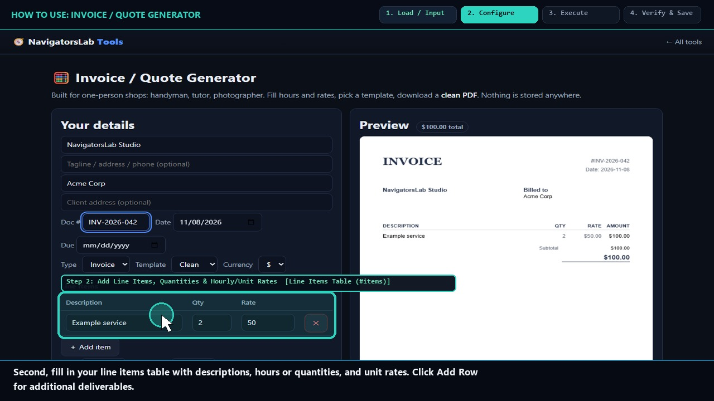
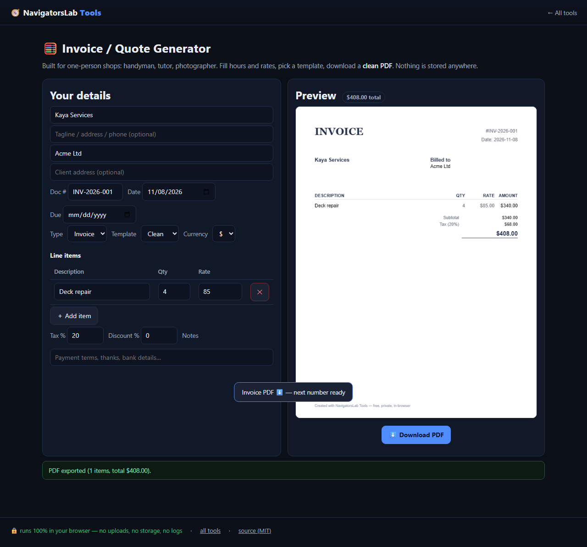

# 🧮 Invoice / Quote Generator

> One-person shops: hours in, clean PDF out

     

<h4 align="center">
  &#9654; <a href="https://navigatorslab.com/tools/invoice.html">Open it on navigatorslab.com</a> &mdash; free, no sign-up, nothing uploaded<br>
  <a href="https://navigatorslab.com/Invoice-Generator">navigatorslab.com/Invoice-Generator</a> &middot; <a href="https://navigatorslab.com/tools/videos/invoice.mp4">🔊 Watch Narrated Step-by-Step Tutorial Video</a> &middot; <a href="https://navigatorslab.com/tools/videos/notebooklm-overview.mp4">Watch Full Suite Hands-On Video</a><br>
  This repo's Pages site runs the <em>actual tool</em>: <code>demo.html</code>
</h4>



Live preview mirrors the PDF exactly. Tax, discount, line items, two templates, five currencies.

## 📖 Complete Step-by-Step User Guide

### Step 1: Enter Business Info, Client Details & Currency (`Header Fields (#biz, #client, #docNo)`)
- **How to do it:** Enter your company/freelancer details in `#biz`, client billing address in `#client`, document number in `#docNo` (e.g., `INV-2026-042`), and pick your currency symbol.
- **Expected result:** Header details populate the live invoice workspace.

### Step 2: Add Line Items, Quantities & Hourly/Unit Rates (`Line Items Table (#items)`)
- **How to do it:** In `#items`, type each deliverable description (`.d`), quantity/hours (`.q`), and rate (`.r`). Click **+ Add line item** to append more rows.
- **Expected result:** Each row subtotal calculates automatically as you type.

### Step 3: Configure Tax Percentage, Discounts & Payment Notes (`Tax (#tax) & Live Total (#total)`)
- **How to do it:** Set your tax percentage in `#tax` (and any discount or payment terms/notes). Verify the calculated subtotal, tax amount, and grand total in `#total`.
- **Expected result:** Exact subtotal, tax, and grand total verified before export.

### Step 4: Download Vector PDF Invoice (`Download PDF Button (#pdf)`)
- **How to do it:** Click **Download PDF (`#pdf`)** to generate a crisp vector PDF via `pdf-lib` (typically ~4 KB, searchable text, razor-sharp at any zoom).
- **Expected result:** Professional `INV-xxxx.pdf` downloaded locally with zero watermarks or platform fees.

## 🎛️ UI Controls, Shortcuts & Parameters Reference

| Control / Shortcut | What It Does |
|---|---|
| `Sender (`#biz`) & Client (`#client`)` | Multi-line business contact, tax ID, and client billing details. |
| `Document Number (`#docNo`) & Currency` | Invoice or quote identifier and currency formatting. |
| `Line Items Table (`#items`) & Tax (`#tax`)` | Dynamic rows for description, quantity, and unit price with automatic tax/discount math. |
| `Download PDF (`#pdf`)` | Generates a clean vector PDF document via `pdf-lib`. |

## 💡 Pro Tips & Real-World Workflows

- 💡 Unlike screenshot-based HTML-to-PDF tools, Invoice Generator draws real vector text streams with `pdf-lib`, so your client's accounting software can copy/paste the invoice number and total cleanly.
- 💡 Include your wire/ACH or payment link in the Notes box at the bottom so clients have everything on one page.
- 💡 Need to sign the quote before sending? Drop the exported invoice PDF straight into **Local E-Sign Pad (`sign.html`)**.

## 🧪 Concrete Example: Input → Engine → Output

| Stage | What Happens | Details |
|---|---|---|
| **1. Raw Input** | **Freelance Consulting Hours & Line Items** | 2 Line Items ($400.00 subtotal), 10% discount (-$40.00), 13.33% tax on discounted subtotal (+$48.00) |
| **2. On-Device Engine** | **Live pdf-lib exact-point layout engine renders real PDF preview in real time as you type** | Runs 100% client-side in your browser tab under strict `CSP` (`connect-src 'none'`). |
| **3. Verified Output** | **INV-2026-042.pdf ($408.00 Total)** | Print-ready vector PDF invoice with itemized table, tax math, payment notes, and zero SaaS watermarks |

```text
Subtotal: $400.00 | Discount (10%): -$40.00 | Tax: +$48.00 | PDF Total: $408.00 [OK]
```

- 🔊 **Narrated Step-by-Step Usage Tutorial Video (`36s`):** [`demo.mp4`](./demo.mp4) (also live at [`https://navigatorslab.com/tools/videos/invoice.mp4`](https://navigatorslab.com/tools/videos/invoice.mp4))
- 🎬 **Full Suite Hands-On Video Guide:** [`https://navigatorslab.com/tools/videos/notebooklm-overview.mp4`](https://navigatorslab.com/tools/videos/notebooklm-overview.mp4)

## ✅ What it does

- Professional invoices and quotes: line items, tax on the discounted subtotal, discounts, notes
- Two templates, five currencies, live preview that mirrors the PDF exactly
- No account, no cloud — your numbers stay yours

## 🚀 Try it in 30 seconds

1. Fill in hours, rates and line items
2. Pick a template, currency, tax and discount
3. Print or save the PDF

## 📸 Live UI in action



## 🔒 Private by design

- **100% on-device** — files are processed in your browser and **never uploaded** to any server
- **No accounts, no tracking, no cookies, nothing retained** — open the page and work
- **Works offline** once loaded; fully mobile-friendly
- **Free & open source (MIT)** — use it at home, at work, anywhere

## 🤖 Built for humans *and* AI agents

- Deep-linkable via URL parameters — see the [Agent Mode guide](https://navigatorslab.com/tools/agents.html)
- Machine-readable catalog: [llms.txt](https://navigatorslab.com/tools/llms.txt) · [llms-full.txt](https://navigatorslab.com/tools/llms-full.txt)
- MCP endpoint: `POST https://navigatorslab.com/tools/mcp` (tool catalog + deterministic text tools — see the [main repo](https://github.com/Kayforkind/NavigatorsLab-Tools))
- No build step required to *use* any tool — just the URL

## 🛠 Under the hood

pdf-lib rendering; the live preview is pixel-identical to the PDF

Third-party components are catalogued in [NOTICE](NOTICE); this repo is MIT-licensed ([LICENSE](LICENSE)).

## 🗂 The NavigatorsLab Tools suite

The full catalog — every tool in the hub with the same zero-upload promise, plus the lab's apps, CLIs and engines:

| Tool | What it does | |
|---|---|---|
| 🛡 Photo Privacy Kit | Strip GPS, camera model and timestamps before posting | [Open](https://navigatorslab.com/tools/exif.html) |
| 🔐 Password Breach Checker | Has this password been breached? — it never leaves your tab | [Open](https://navigatorslab.com/tools/breachcheck.html) |
| 🔍 Metadata & Hidden-Data Checker | See what's really inside a file — then strip it | [Open](https://navigatorslab.com/tools/metadata.html) |
| 🗜 Image Shrinker | Hit “max 2 MB” portal limits without TinyPNG | [Open](https://navigatorslab.com/tools/shrink.html) |
| 📄 Scan & Screenshot Cleaner | Phone photos of documents → clean, straight PDFs | [Open](https://navigatorslab.com/tools/scan.html) |
| ✍ Local E-Sign Pad | Sign this lease tonight — not DocuSign | [Open](https://navigatorslab.com/tools/sign.html) |
| 🧾 Receipts → One PDF | Shoebox of receipt photos → one date-sorted PDF | [Open](https://navigatorslab.com/tools/receipts.html) |
| 🔢 Receipt OCR → CSV | Read totals off receipt photos, export for expenses | [Open](https://navigatorslab.com/tools/ocr.html) |
| 🔳 QR Studio | Generate QR codes and decode QR images — no site sees them | [Open](https://navigatorslab.com/tools/qr.html) |
| 🎧 Audio Trimmer | Cut voice notes and clips on a waveform | [Open](https://navigatorslab.com/tools/audio.html) |
| **🧮 Invoice / Quote Generator** | One-person shops: hours in, clean PDF out | [Open](https://navigatorslab.com/tools/invoice.html) |
| 🗂 Batch Rename & Sort | IMG_5847.jpg → 2026-09-05-receipt-home-depot.jpg | [Open](https://navigatorslab.com/tools/rename.html) |
| 🖨 Print-Shop Prep | Exact sizes, bleed, DPI checks, print-ready PDF | [Open](https://navigatorslab.com/tools/printprep.html) |
| 📑 PDF Pages | Reorder, rotate, delete and extract PDF pages | [Open](https://navigatorslab.com/tools/pdfpages.html) |
| 🔬 Text Diff | Compare two texts with word-level highlights | [Open](https://navigatorslab.com/tools/textdiff.html) |
| 🎨 Reimagine | Redesign any HTML page from its own content | [Open](https://navigatorslab.com/reimagine/) |
| 📊 Text Stats | Words, reading time, readability, keyword density | [Open](https://navigatorslab.com/tools/textstats.html) |
| 📜 PDF Studio | Edit the text inside your PDF — private, free, open source | [Open](https://navigatorslab.com/pdf-studio/) |
| 🩺 Design Health | 18 deterministic design-quality checks for HTML — no LLM, no API key | [Open](https://github.com/Kayforkind/design-health-action) |
| 🔪 Skill Slice | Copy one Read-verified skill folder — a slice, not the pie | [Open](https://github.com/Kayforkind/skill-slice) |
| 🕵 liecatchers | Your agent said Done. Prove it — ten sensors, one RECEIPT.json | [Open](https://github.com/Kayforkind/liecatchers) |
| 📚 Book Guide MCP | Ship improvements with your books — agents cite, run playbooks, learn | [Open](https://github.com/Kayforkind/book-guide-mcp) |
| 📡 Data Insights | Founder intelligence — daily & weekly tech signal briefs | [Open](https://github.com/Kayforkind/data-insights) |
| 🪓 Iron Axe: Legacy | An original side-scrolling beat 'em up — Godot 4 | [Open](https://github.com/Kayforkind/iron-axe-legacy) |

---

<p align="center">
  <b>One hub, twenty-four projects:</b> <a href="https://navigatorslab.com/tools/">https://navigatorslab.com/tools</a><br>
  <b>Source &amp; the whole suite:</b> <a href="https://github.com/Kayforkind/NavigatorsLab-Tools">https://github.com/Kayforkind/NavigatorsLab-Tools</a>
</p>
